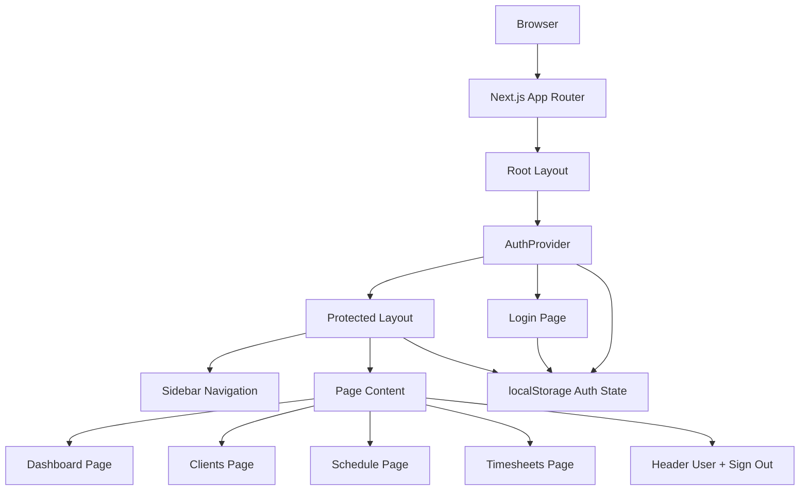
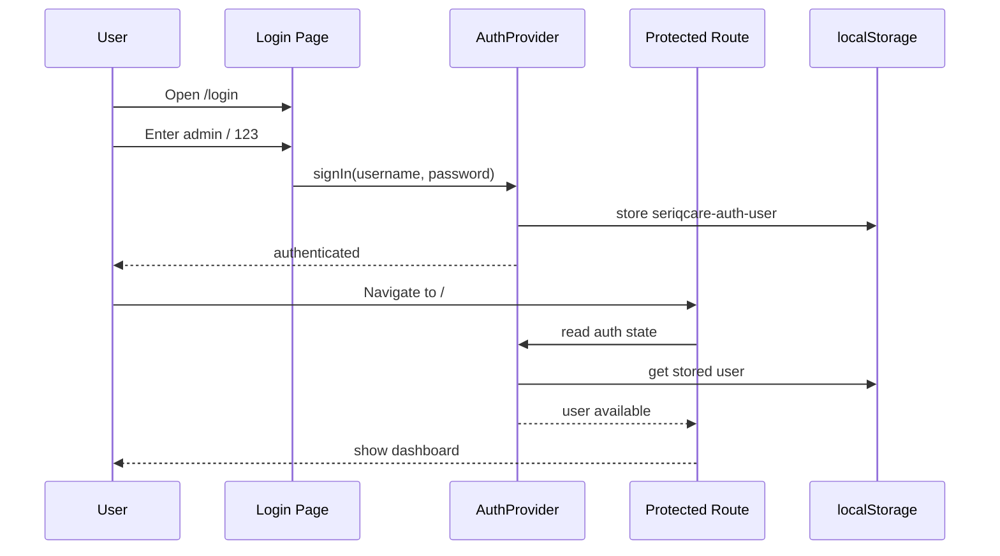

# SeriqCare Architecture

This project uses the Next.js App Router with a small client-side authentication layer and shared reusable UI components.

## Overview

- `app/layout.tsx` wraps the app in `AuthProvider`
- `auth-context.tsx` manages login state using localStorage
- `protected-layout.tsx` blocks access to protected routes when not signed in
- `sidebar.tsx` renders the left navigation
- `topbar.tsx` shows the current user and sign-out action
- each page under `app/` renders a specific module UI

## Mermaid diagram

## Route flow

## Suggested future production upgrades

- move authentication to a secure server-side solution
- add role-based access control
- fetch clients, schedules, and timesheets from APIs
- split large page sections into more reusable components
- add a data layer with TanStack Query or server actions
