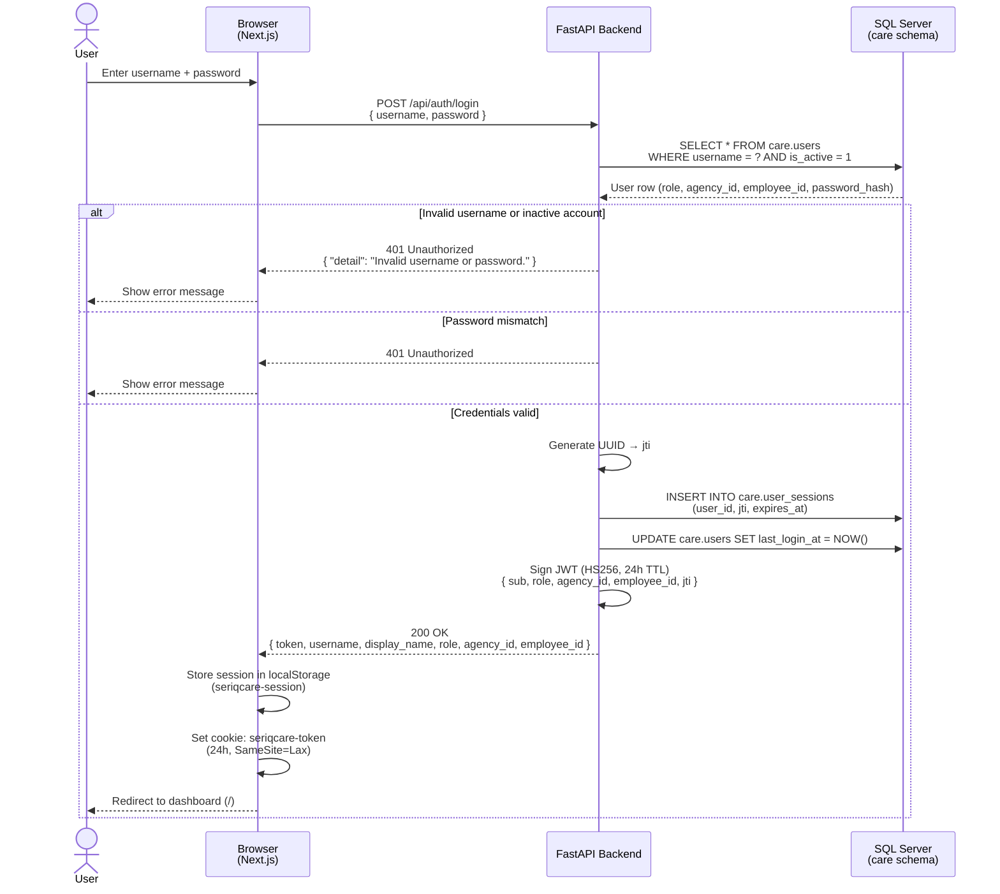
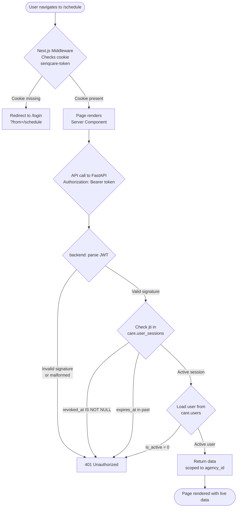
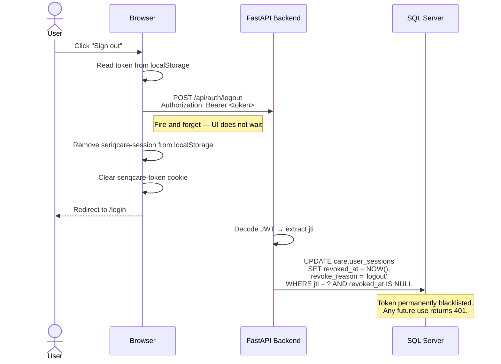
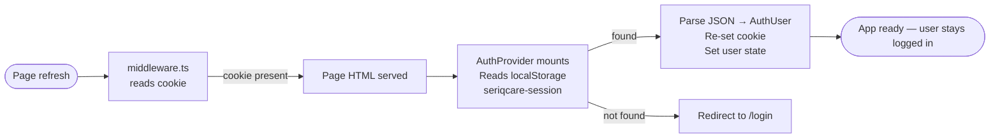
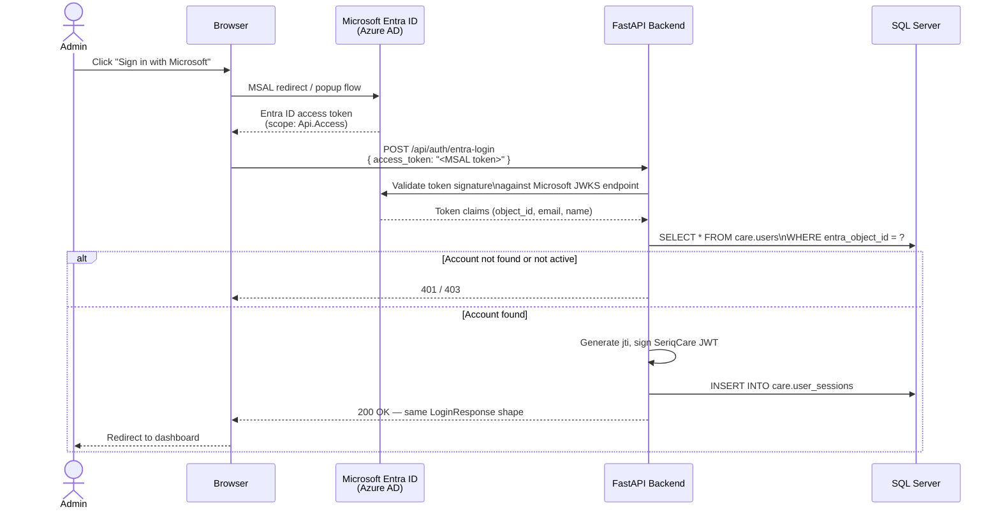
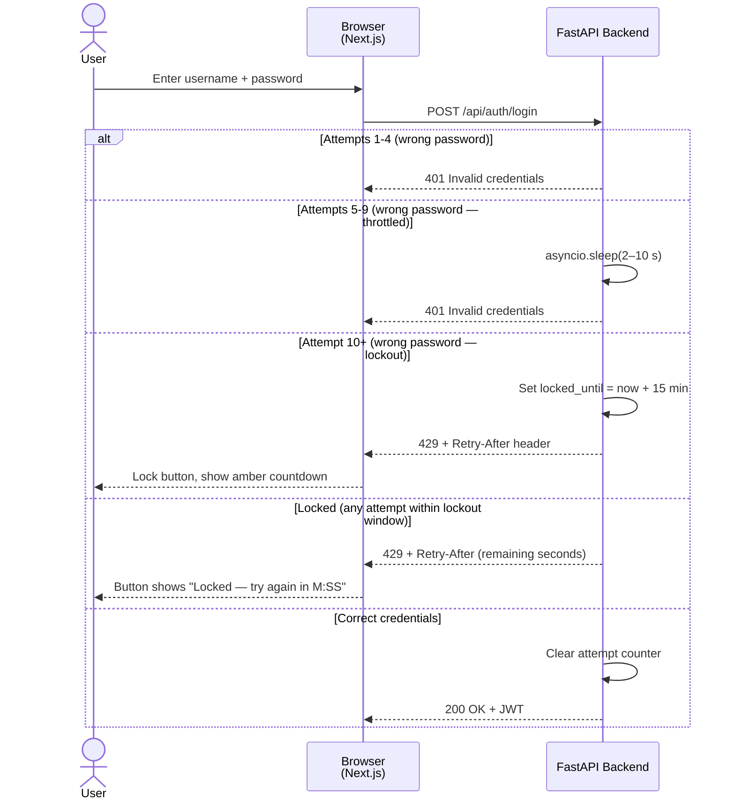

# SeriqCare Authentication

> **Document scope:** Covers how users log in, how sessions are protected, and how the system decides what each user is allowed to see and do.

---

## For Non-Technical Readers

Think of SeriqCare authentication like a secure building with a front desk and a key card system.

**Signing in**
When you open the app and enter your username and password, the front desk (backend server) checks your credentials against the staff directory (the database). If everything matches, the desk hands you a **temporary key card** — a digital token that is valid for **24 hours**. You do not need to log in again within that window.

**Navigating the app**
Every time you click on a page, a door sensor (the middleware) checks whether you are carrying a valid key card. If you have one, the door opens immediately — no delay, no extra login prompt. If you do not have one (session expired, never logged in), you are redirected to the sign-in page.

**What you can do depends on your role**
Not every staff member can access every room. The key card encodes your job role:

| Who you are | What you can access |
|---|---|
| **Caregiver (DSP)** | Your own schedule and clock-in/out |
| **Coordinator** | Everything above + visit approvals, exceptions, caregiver oversight |
| **Agency Admin** | Everything a coordinator can do, across the whole agency |
| **Super Admin** | Platform-wide access (SeriqCare internal staff only, uses company login) |

**Signing out**
When you click *Sign out*, your key card is immediately cancelled at the server. Even if someone copied your key card, it will no longer open any doors.

**Your data stays with your agency**
Each key card is stamped with your agency ID. The server never reads your agency from the request you send — it reads it from the key card itself. One agency's data is never visible to another.

---

## System Architecture

```
┌──────────────────────────────────────────────────────────────────────────┐
│                          SeriqCare Platform                              │
│                                                                          │
│  Browser / Mobile Client                                                 │
│  ┌───────────────────────────┐                                           │
│  │  Next.js 15 Frontend      │                                           │
│  │  ┌─────────────────────┐  │                                           │
│  │  │  middleware.ts       │  │  ← Edge: checks seriqcare-token cookie   │
│  │  │  (route guard)       │  │                                          │
│  │  ├─────────────────────┤  │                                           │
│  │  │  auth-context.tsx   │  │  ← Client: stores session, calls API     │
│  │  │  (React Context)    │  │                                           │
│  │  └─────────────────────┘  │                                           │
│  └────────────┬──────────────┘                                           │
│               │  HTTP  (Bearer JWT)                                      │
│  ┌────────────▼──────────────┐                                           │
│  │  FastAPI Backend          │                                           │
│  │  ┌─────────────────────┐  │                                           │
│  │  │  /api/auth/login    │  │  ← Issues JWT + records session          │
│  │  │  /api/auth/logout   │  │  ← Revokes jti in DB                     │
│  │  ├─────────────────────┤  │                                           │
│  │  │  dependencies.py    │  │  ← Validates JWT on every protected call  │
│  │  │  get_current_user() │  │                                           │
│  │  └─────────────────────┘  │                                           │
│  └────────────┬──────────────┘                                           │
│               │  SQLAlchemy                                              │
│  ┌────────────▼──────────────┐                                           │
│  │  SQL Server (care schema) │                                           │
│  │  care.users               │  ← Credentials, roles, agency linkage    │
│  │  care.user_sessions       │  ← Active JTIs + revocation timestamps   │
│  └───────────────────────────┘                                           │
└──────────────────────────────────────────────────────────────────────────┘
```

---

## User Roles & Permissions

Roles are stored in `care.users.role` and embedded in the JWT. The backend reads only the JWT — the client never self-reports a role.

| Role | DB Value | Description | `employee_id` |
|---|---|---|---|
| Caregiver | `caregiver` | DSP field staff — schedule + EVV clock-in/out | Populated (links to `care.employees`) |
| Coordinator | `coordinator` | Office staff — visit management, exceptions | NULL |
| Agency Admin | `agency_admin` | Full agency access, same as coordinator | NULL |
| Super Admin | `super_admin` | SeriqCare internal — crosses all agencies; authenticates via Entra ID only | NULL |

Agency-scoped access uses the authenticated user's agency membership, not an agency supplied in the request. Super admins have cross-agency access. Tenant isolation is not yet enforced consistently across all endpoints; see the security review before relying on it in production.

AgencyScope rejects non-super-admin users without an agency. Billing claim grouping, bulk generation, status updates, and caregiver payroll endpoints require agency staff or super-admin authentication and use the owning agency. Schedules use the client's agency and require the assigned caregiver to belong to that same agency, including for super-admin operations. Client statistics are restricted to the selected agency and client filters.

Payroll pay groups and rates are currently shared globally: the payroll settings endpoint can modify shared groups and employee settings across agencies. Caregiver payroll endpoint isolation does not isolate those shared settings; do not rely on payroll configuration as tenant-isolated until that separate issue is addressed.

Client details, insurance, authorizations, visits, updates, and care-task management require coordinator, agency-admin, or super-admin access. Non-super-admin staff must belong to the client's agency. Caregivers may update task completion only for an active client in their agency with a non-cancelled schedule assigned to their employee record.

Mobile clock-in requires an employee and agency linked to the authenticated user, a non-cancelled schedule assigned to that employee, and matching agency ownership for the schedule, client, and employee. Clock-out and mobile visit history are restricted to that employee and agency.

Aggregator queue, history, submissions, batch operations, retries, and mode require coordinator, agency-admin, or super-admin access. Staff without an agency are denied; super admins have cross-agency access. Submitted visits and their clients and employees must belong to the same agency. Sandata submissions require an active provider owned by the visit's agency whose provider ID matches `care.agencies.sandata_provider_id`; missing or mismatched configuration blocks submission. Sandata retry does not submit HHAeXchange records.

Live Sandata credentials are configured globally, not per agency. A live submission is blocked unless `SANDATA_PROVIDER_ID` matches the visit agency's provider ID. Supporting multiple live provider credentials requires separate configuration. Simulator mode sends visit data to the configured simulator service; it is not necessarily local.

---

## Authentication Flows

### 1. Login — Username & Password (Caregivers & Coordinators)



---

### 2. Accessing a Protected Page

Two layers of protection work in sequence on every navigation:



---

### 3. Logout



---

### 4. Session Rehydration (Page Refresh)

When a user refreshes the browser, the React app restarts and re-reads localStorage:



---

### 5. Admin Login — Microsoft Entra ID / MSAL (Planned — Phase 2)

Super admins authenticate through the organisation's Microsoft identity, not a local password. The backend exchanges the Microsoft token for a SeriqCare JWT of identical shape to the standard login response.



---

## Token Specification

### JWT Claims

| Claim | Type | Description |
|---|---|---|
| `sub` | string | Username (e.g. `coordinator1`) |
| `role` | string | `caregiver` \| `coordinator` \| `agency_admin` \| `super_admin` |
| `agency_id` | int \| null | Database ID of the user's agency. `null` for super_admin. |
| `employee_id` | int \| null | Links DSP caregivers to `care.employees`. `null` for office staff. |
| `jti` | UUID string | Unique token ID — used for revocation lookup in `care.user_sessions`. |
| `iat` | Unix timestamp | Issued-at time (UTC) |
| `exp` | Unix timestamp | Expiry — 24 hours after `iat` |

### Signing

- **Algorithm:** HS256 (HMAC-SHA256)
- **Secret:** Set via `SECRET_KEY` environment variable
- **Library:** `python-jose[cryptography]`

> Before deploying to production, replace the default `SECRET_KEY` with a long random string (minimum 32 characters). Rotating this key invalidates all active sessions.

---

## Database Tables

### `care.users`

Stores all platform users. One row per person regardless of role.

| Column | Notes |
|---|---|
| `username` | Unique login name |
| `display_name` | Shown in the UI top bar |
| `role` | Enforced by `CHECK` constraint: `caregiver`, `coordinator`, `agency_admin`, `super_admin` |
| `agency_id` | FK → `care.agencies`. `NULL` for super_admin. |
| `employee_id` | FK → `care.employees`. Populated for caregivers only. |
| `password_hash` | bcrypt hash. `NULL` for Entra ID-only accounts. |
| `entra_object_id` | Microsoft object GUID. `NULL` for SQL-authenticated users. |
| `is_active` | `0` immediately blocks login without deleting the record. |
| `last_login_at` | Updated on every successful login. |

### `care.user_sessions`

Tracks every issued JWT. Revocation is instant — no need to wait for expiry.

| Column | Notes |
|---|---|
| `jti` | UUID matching the `jti` claim in the JWT. Unique index. |
| `user_id` | FK → `care.users.id` |
| `issued_at` | When the token was created |
| `expires_at` | 24 hours after `issued_at` |
| `revoked_at` | `NULL` = active. Set to revocation time on logout. |
| `revoke_reason` | `'logout'` or future values (`'admin_revoke'`, `'password_change'`) |

---

## API Endpoints

### `POST /api/auth/login`

**Request body:**
```json
{
  "username": "coordinator1",
  "password": "<password>"
}
```

**Response 200:**
```json
{
  "token":        "<SeriqCare JWT>",
  "username":     "coordinator1",
  "display_name": "Care Coordinator",
  "role":         "coordinator",
  "agency_id":    1,
  "employee_id":  null
}
```

**Response 401:**
```json
{ "detail": "Invalid username or password." }
```

**Response 429 — Rate Limited:**
```json
{ "detail": "Too many failed attempts. Account locked — try again in 15 minutes." }
```
Headers: `Retry-After: <seconds>`

---

### `POST /api/auth/logout`

**Request header:**
```
Authorization: Bearer <token>
```

**Response:** `204 No Content` (always — even if token was already revoked)

---

### Protected endpoints (all other routes)

Every protected route uses `get_current_user()` from `backend/auth/dependencies.py`. The full validation sequence on each request:

1. Extract `Authorization: Bearer <token>` header
2. Decode JWT signature using `SECRET_KEY`
3. Extract `jti` from claims
4. Query `care.user_sessions WHERE jti = ?`
5. Reject if row not found, `revoked_at IS NOT NULL`, or `expires_at` is in the past
6. Query `care.users WHERE username = sub AND is_active = 1`
7. Reject if user not found or inactive
8. Inject `User` object into the route handler

**Role-gating example:**
```python
from backend.auth.dependencies import require_role

@router.get("/approvals")
def get_approvals(current_user = Depends(require_role("coordinator", "agency_admin"))):
    ...
```

---

## Rate Limiting & Brute-Force Protection

Login attempts are rate-limited **per username** using an in-memory counter on the backend (`backend/routers/auth.py`).

### Thresholds

| Failed attempts | Behaviour |
|---|---|
| 1 – 4 | Normal 401 response, no delay |
| 5 – 9 | **Throttle** — server adds a progressive delay before responding: 2 s on the 5th failure, 4 s on the 6th, … capped at 10 s |
| 10+ | **Temporary lockout** — 429 returned immediately with `Retry-After` header. Lockout lasts **15 minutes**. |

### Reset

- The counter is **cleared on a successful login**, so a user who accidentally mistyped a password will not be punished after they sign in correctly.
- The lockout timer **auto-expires** after 15 minutes — no admin action required.

### Sequence



### Frontend behaviour

When the backend returns HTTP 429:

- The `Retry-After` header value (seconds) is read by `auth-context.tsx` and passed back as `retryAfter`.
- `app/login/page.tsx` sets a `lockedUntil` timestamp and starts a 1-second countdown ticker.
- The sign-in button is **disabled** and displays `Locked — try again in M:SS`.
- Input fields are also disabled during lockout.
- When the timer reaches zero, the form re-enables and the error banner clears automatically.
- Lockout errors are shown with an **amber** warning style (as opposed to the standard red for invalid credentials).

### Storage

The attempt store is **in-memory** (a Python dict protected by a `threading.Lock`). This means:

- Counters reset if the backend process restarts.
- In a multi-process / multi-worker deployment, each worker has its own counter — use Redis with `slowapi` or similar for distributed rate limiting.

---

## Client-Side Storage

| Storage | Key | Contents | Lifetime |
|---|---|---|---|
| `localStorage` | `seriqcare-session` | Full `AuthUser` JSON: token, username, display_name, role, agency_id, employee_id | Cleared on sign-out |
| Cookie | `seriqcare-token` | Raw JWT string | 24h or cleared on sign-out |

The cookie is **not `httpOnly`** so the JavaScript `signOut()` function can delete it client-side. The Next.js middleware reads this cookie at the edge before the page renders.

> The JWT itself is not a secret that must be hidden from JavaScript — its claims (role, username) are intentionally readable. The signature, however, cannot be forged without the server's `SECRET_KEY`.

---

## Development Mode

When `DEV_NO_HASH_AUTH=true` in `.env`:

- **Password check is bypassed** — any active user can log in by entering the value of `DEV_PASSWORD`
- `password_hash` in the database is ignored entirely — no bcrypt calls are made
- All other logic (JWT issuance, jti tracking, session storage) works identically to production
- This mode must **never** be set to `true` in production

Seeded dev users (from `sql/seriqcare_evv_ddl.sql`):

| Username | Role | Notes |
|---|---|---|
| `coordinator1` | coordinator | Default demo login |
| `sarah.mills` | caregiver | Linked to employee EMP001 |
| `linda.brooks` | caregiver | Linked to employee EMP002 |
| `rachel.dunn` | caregiver | Linked to employee EMP003 |
| `angela.reese` | caregiver | Linked to employee EMP004 |
| `natalie.ford` | caregiver | Linked to employee EMP005 |
| `niyi` | caregiver | Pilot login, maps to EMP001 |
| `caregiver1` | caregiver | Pilot login, maps to EMP002 |
| `admin` | super_admin | Entra ID only — no password |

---

## Production Checklist

Before going live, verify the following:

- [ ] `SECRET_KEY` is set to a long random string (minimum 32 characters) — never commit it to source control
- [ ] `DEV_NO_HASH_AUTH=false` (or variable removed entirely)
- [ ] `DEV_PASSWORD` removed from `.env`
- [ ] All user `password_hash` values are bcrypt hashes — run the hash-seeding script to replace `NULL` hashes
- [ ] `care.users` rows for production staff created with correct roles and `agency_id`
- [ ] `care.user_sessions` table has the index `UQ_user_sessions_jti` in place (created by DDL)
- [ ] HTTPS enforced — the JWT travels in the `Authorization` header on every request
- [ ] CORS `allow_origins` set to your production domain only (not `*`)
- [ ] Cookie `SameSite` and `Secure` flags reviewed for production domain
- [ ] Rate limiting: replace in-memory `_attempt_store` with Redis-backed store (e.g. `slowapi`) if running multiple backend workers
- [ ] CAPTCHA integration enabled for production (hCaptcha or Cloudflare Turnstile recommended)

---

## Planned: CAPTCHA Integration

CAPTCHA verification is not yet implemented. It is planned as a hardening layer on top of the existing rate limiting.

### Trigger condition

CAPTCHA should be presented to the user **after 3 consecutive failed login attempts** for a username — before the throttle delay activates.

### Recommended approach

| Option | Notes |
|---|---|
| **hCaptcha** | Privacy-friendly, HIPAA-compatible, free tier available |
| **Cloudflare Turnstile** | Invisible / non-intrusive, no image puzzles, free |
| **Google reCAPTCHA v3** | Risk-score based (invisible), but shares data with Google |

### Implementation sketch

1. **Frontend** — after 3 failures, render a CAPTCHA widget (hCaptcha / Turnstile).
2. **Frontend** — include the CAPTCHA token in the login request body: `{ username, password, captcha_token }`.
3. **Backend** — before credential check, call the CAPTCHA verification API with the token and the client IP.
4. **Backend** — reject the login with `422` if the CAPTCHA fails (do not increment the attempt counter).
5. **Backend** — skip CAPTCHA verification when `DEV_NO_HASH_AUTH=true` (dev mode).

### Why it matters

Rate limiting alone slows down brute-force attacks but does not stop distributed attempts from many IPs. CAPTCHA adds a human-verification layer that:

- Stops automated credential stuffing even across distributed IP pools.
- Reduces backend load by rejecting bots before they reach the DB query.
- Complies with HIPAA guidance on access controls for protected health information systems.

---

## Planned: Phase 2 — Entra ID Login

The Microsoft Entra ID (Azure AD) login path for `super_admin` accounts is designed but not yet implemented in the backend. The app registration is provisioned:

- **Tenant:** `5b87ad44-…` (SeriqCare Azure tenant)
- **App URI:** `api://28bdc2af-…`
- **Scope:** `api://28bdc2af-…/Api.Access`

When implemented, the endpoint `POST /api/auth/entra-login` will:
1. Validate the MSAL access token against Microsoft's JWKS endpoint
2. Look up the user by `entra_object_id` in `care.users`
3. Return an identical `LoginResponse` shape — the frontend requires no changes
