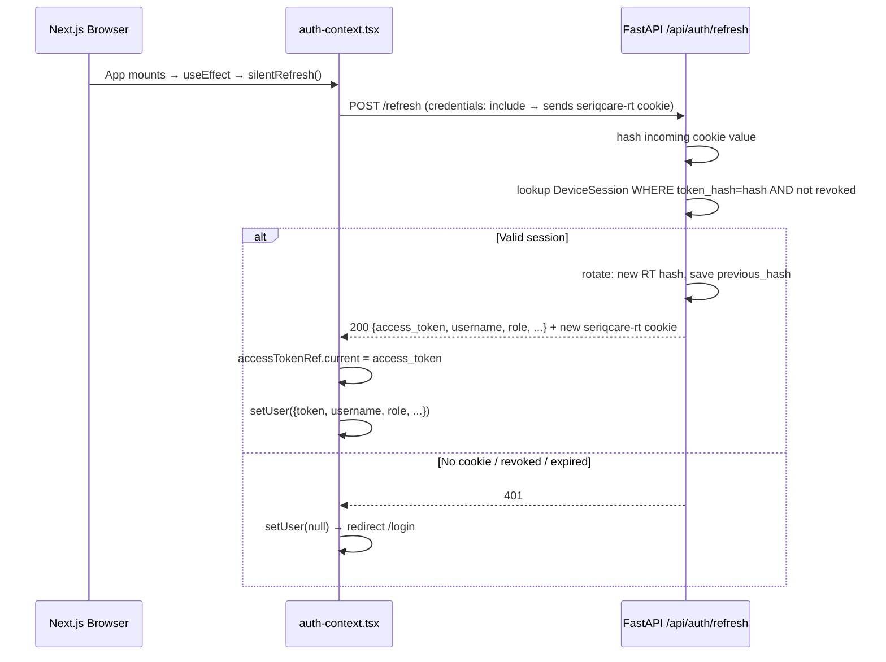
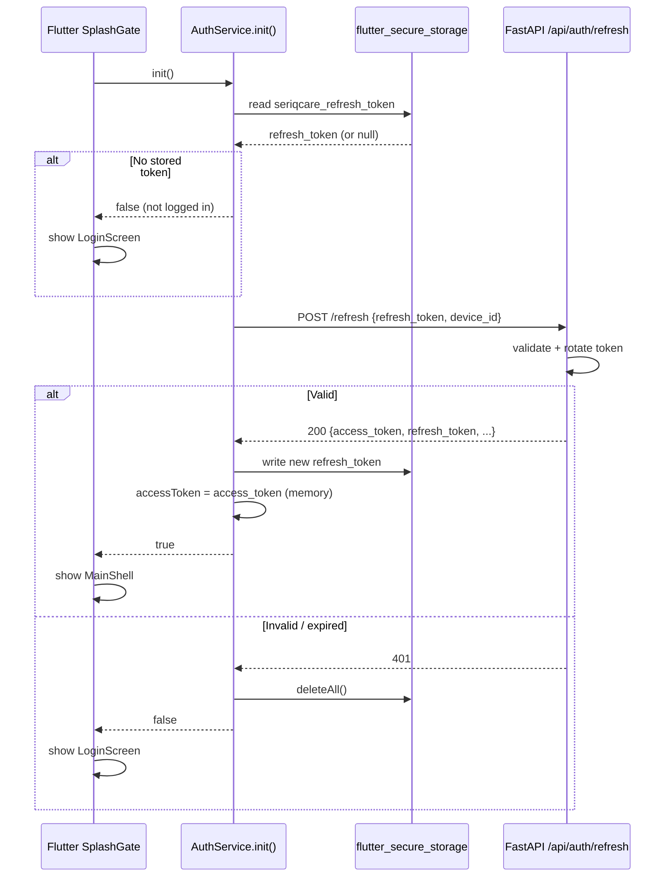
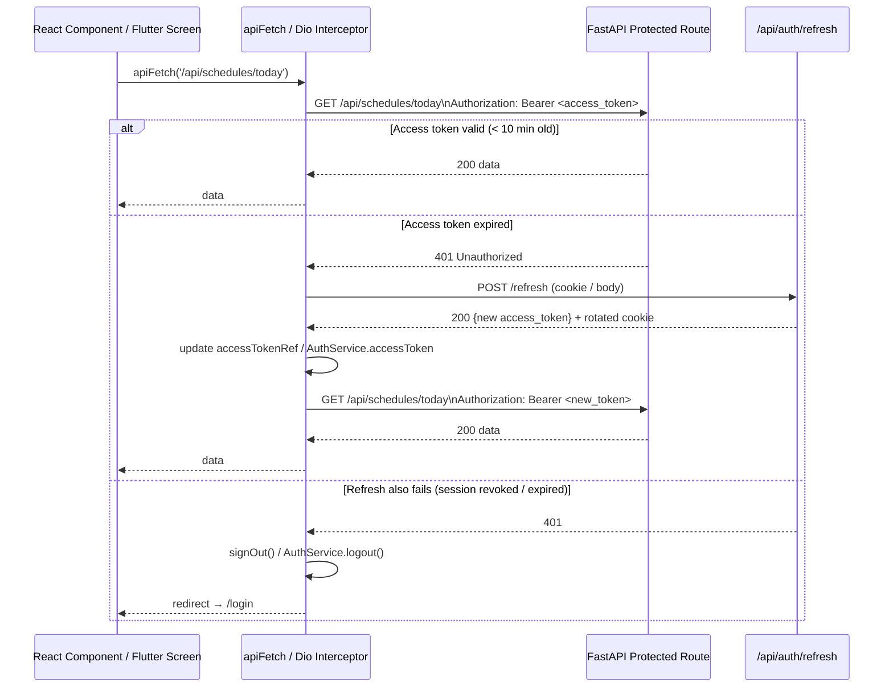
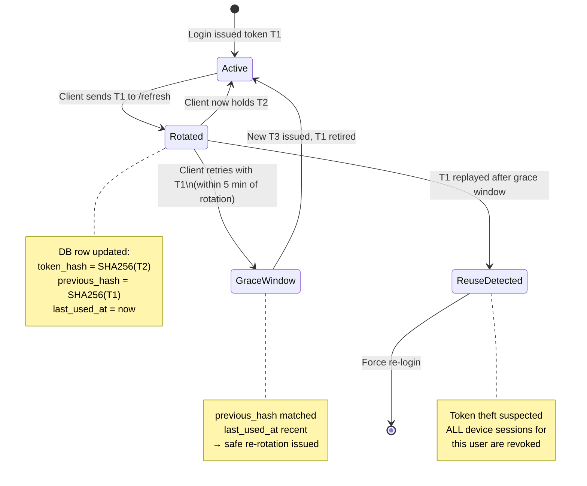
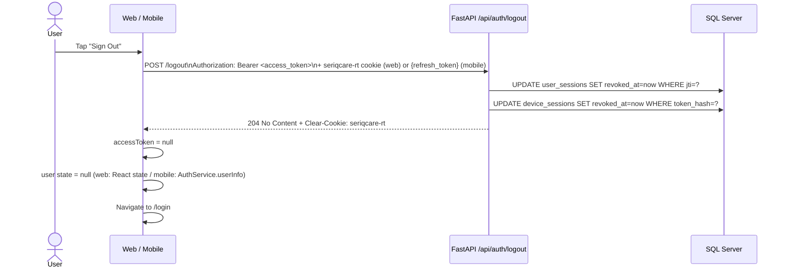

# SeriqCare Authentication System

## Overview

The authentication system uses a **dual-token strategy** — a short-lived access token for API calls and a long-lived refresh token for session continuity — across three surfaces: the FastAPI backend, the Next.js web portal, and the Flutter mobile app.

| Surface | Access Token | Refresh Token |
|---|---|---|
| **Web Portal** | In-memory React state (never written to disk) | HttpOnly `seriqcare-rt` cookie (server-only, JS can't read it) |
| **Flutter App** | In-memory Dart variable (`AuthService.accessToken`) | `flutter_secure_storage` (Keychain on iOS, Keystore on Android) |
| **Backend** | JWT HS256 — 10 min TTL, jti tracked in `care.user_sessions` | Opaque 64-char random string — SHA-256 hashed in `care.device_sessions` |

---

## Why Two Tokens?

| Problem with single long-lived tokens | Solution |
|---|---|
| A stolen JWT gives an attacker unlimited access until expiry (24 h) | Access tokens now expire in **10 minutes** — stolen tokens are useless quickly |
| Tokens in `localStorage` are readable by any JS on the page (XSS) | Access tokens live in **memory only** (React `useRef` / Dart variable) |
| No way to revoke a specific device without revoking all sessions | Each device gets its own **device session** row — revoke one without touching others |
| No audit trail of login/refresh activity | Every event lands in `care.auth_log` |

---

## Token Lifetimes

```
Access token:   ████░░░░░░░░░░░░░░░░░░░░  10 minutes
Refresh token:  ████████████████████████  30 days
Grace window:   ▓                          5 minutes (for rotation retries)
```

---

## Architecture — Files Changed / Created

### Backend (`backend/`)

| File | Change | Purpose |
|---|---|---|
| `backend/services/auth_tokens.py` | **NEW** | Token generation utilities (`make_access_token`, `generate_refresh_token`, `hash_token`) |
| `backend/routers/auth.py` | **REWRITTEN** | New login/refresh/logout endpoints with refresh token support |
| `backend/services/migrations.py` | **UPDATED** | Phase 4: creates `care.device_sessions` + `care.auth_log` tables on startup |
| `db/models.py` | **UPDATED** | Added `DeviceSession` and `AuthLog` ORM models; `User.device_sessions` relationship |

### Web Portal (`components/`, `middleware.ts`)

| File | Change | Purpose |
|---|---|---|
| `components/auth-context.tsx` | **REWRITTEN** | In-memory access token, silent refresh from HttpOnly cookie, `apiFetch` helper |
| `middleware.ts` | **UPDATED** | Checks `seriqcare-rt` HttpOnly cookie (server-side readable) instead of JS token |
| `app/settings/page.tsx` | **UPDATED** | Uses `apiFetch` instead of raw fetch with `user.token` |

### Flutter App (`dev_mobile/seriqcare_mobile/`)

| File | Change | Purpose |
|---|---|---|
| `pubspec.yaml` | **UPDATED** | Added `flutter_secure_storage ^9.2.2` + `dio ^5.7.0` |
| `lib/services/auth_service.dart` | **NEW** | Singleton managing secure token storage + login/refresh/logout |
| `lib/services/api_client.dart` | **NEW** | Dio client with automatic silent-refresh interceptor |
| `lib/main.dart` | **UPDATED** | `ApiService` + `SplashGate` + `_logout` use `AuthService` instead of `SharedPreferences` |

---

## Database Schema — New Tables

### `care.device_sessions`

```sql
id            INT IDENTITY PK
user_id       INT           FK → care.users
device_id     VARCHAR(100)  -- client-generated UUID (stable per install)
device_name   VARCHAR(200)  -- "Flutter App", "Chrome on Windows"
client_type   VARCHAR(10)   -- 'web' | 'mobile'
token_hash    VARCHAR(64)   -- SHA-256(current_refresh_token)  UNIQUE
previous_hash VARCHAR(64)   -- SHA-256(previous token) for grace-window retries
issued_at     DATETIME2
expires_at    DATETIME2     -- 30 days from last login
last_used_at  DATETIME2
revoked_at    DATETIME2     -- NULL = active
revoke_reason VARCHAR(50)   -- 'logout' | 'replaced' | 'reuse_detected'
```

### `care.auth_log`

```sql
id          INT IDENTITY PK
user_id     INT          -- NULL for failed logins (user not found)
username    VARCHAR(100)
event       VARCHAR(30)  -- login_ok | login_fail | refresh_ok | logout | reuse_detected
client_type VARCHAR(10)
device_id   VARCHAR(100)
ip_address  VARCHAR(45)
user_agent  VARCHAR(500)
detail      VARCHAR(500)
created_at  DATETIME2
```

---

## Flow Diagrams

### 1. Login Flow

```mermaid
sequenceDiagram
    actor User
    participant Client as Web / Mobile
    participant Backend as FastAPI /api/auth/login
    participant DB as SQL Server

    User->>Client: Enter username + password
    Client->>Backend: POST /login {username, password, client_type, device_id}
    Backend->>DB: SELECT user WHERE username=? AND is_active=1
    DB-->>Backend: user row
    Backend->>Backend: verify_password(plain, hash)

    alt Invalid credentials
        Backend-->>Client: 401 Unauthorized
    end

    Backend->>DB: INSERT care.user_sessions (jti, expires=+10min)
    Backend->>DB: UPSERT care.device_sessions (token_hash, expires=+30d)
    Backend->>DB: UPDATE users SET last_login_at=now

    alt Web client
        Backend-->>Client: 200 {access_token} + Set-Cookie: seriqcare-rt=<rt>; HttpOnly
    else Mobile client
        Backend-->>Client: 200 {access_token, refresh_token}
    end

    Client->>Client: Store access_token in MEMORY only
    Note over Client: Web: React useRef / Mobile: Dart variable
    Note over Client: Refresh token: HttpOnly cookie (web) or flutter_secure_storage (mobile)
```

---

### 2. Silent Refresh Flow (Web — on page load)



---

### 3. Silent Refresh Flow (Flutter — on app start)



---

### 4. API Call with Automatic Token Refresh



---

### 5. Refresh Token Rotation & Grace Window



---

### 6. Logout Flow



---

## Security Properties

### What is protected against

| Threat | Mitigation |
|---|---|
| **XSS stealing tokens** | Access token is in JS memory (not `localStorage`). Refresh token is HttpOnly — JS cannot read it. |
| **CSRF** | Cookie is `SameSite=Lax`. Refresh endpoint requires the cookie to be present (not just any cross-site POST). |
| **Refresh token theft** | Tokens are stored as SHA-256 hashes — raw token never written to DB. Even a DB dump is useless. |
| **Token reuse / replay** | Grace-window rotation: reusing an already-rotated token triggers full session revocation for that user. |
| **Long-lived exposure** | Access tokens expire in 10 min. Even if intercepted, the window is narrow. |
| **Brute-force login** | Rate limiting: 5 failures → progressive delay (2–10 s). 10 failures → 15-minute lockout. |
| **Stale sessions after password change** | Refresh tokens can be individually revoked per device (coordinator admin-reset endpoint). |
| **Mobile device storage** | Refresh token in Keychain (iOS) / Keystore (Android) via `flutter_secure_storage` — not accessible to other apps or backups. |

### Cookie attributes (`seriqcare-rt`)

```
HttpOnly   → JavaScript cannot read it (XSS-resistant)
SameSite=Lax → Sent on same-site navigations, blocked on cross-site POSTs (CSRF-resistant)
Secure     → HTTPS only in production (set COOKIE_SECURE=true env var on Render)
Path=/     → Sent on all requests to the domain
Max-Age    → 30 days (matches device_session.expires_at)
```

---

## Environment Variables

Add to `.env` (backend):

```bash
# Auth
SECRET_KEY=<long-random-string>          # JWT signing key
COOKIE_SECURE=true                        # Set to true in production (HTTPS)

# Entra ID (optional — for super_admin SSO)
ENTRA_TENANT_ID=<azure-tenant-id>
ENTRA_CLIENT_ID=<azure-app-client-id>
ENTRA_APP_URI=api://<azure-app-client-id>
```

---

## API Reference

### `POST /api/auth/login`

```json
// Request
{
  "username": "jsmith",
  "password": "MyP@ssword1",
  "client_type": "web",          // "web" | "mobile"
  "device_id": "uuid-optional",  // generated server-side if absent
  "device_name": "Chrome on Windows"
}

// Response (web) — refresh token set as HttpOnly cookie
{
  "access_token": "<10-min-jwt>",
  "token_type": "bearer",
  "username": "jsmith",
  "display_name": "John Smith",
  "role": "coordinator",
  "agency_id": 1,
  "employee_id": null
}

// Response (mobile) — refresh token also in body
{
  "access_token": "<10-min-jwt>",
  "refresh_token": "<30-day-opaque>",
  ...
}
```

### `POST /api/auth/refresh`

```json
// Web: no body needed — reads seriqcare-rt HttpOnly cookie
// Mobile:
{ "refresh_token": "<stored-token>", "device_id": "<uuid>" }

// Response
{ "access_token": "<new-10-min-jwt>", "token_type": "bearer", "username": "...", ... }
// Web also receives rotated seriqcare-rt cookie
// Mobile also receives "refresh_token": "<new-30-day-token>"
```

### `POST /api/auth/logout`

```http
Authorization: Bearer <access_token>
Cookie: seriqcare-rt=<token>    (web — sent automatically)

// Mobile body (optional):
{ "refresh_token": "<stored-token>" }

// Response: 204 No Content
// Web: seriqcare-rt cookie cleared
```

---

## Flutter Integration Notes

### `AuthService` (singleton)

```dart
// App startup
final restored = await AuthService.instance.init();
// → tries silent refresh from secure storage
// → returns true if a valid session was found

// Login
await AuthService.instance.login(username, password);
// → stores refresh token in flutter_secure_storage
// → stores access token in .accessToken (memory)

// Get current user
AuthService.instance.userInfo?.displayName
AuthService.instance.accessToken  // null if not logged in

// Logout
await AuthService.instance.logout();
// → revokes server session + clears all secure storage
```

### `ApiClient` (Dio with interceptor)

```dart
// All API calls go through:
final response = await ApiClient.instance.dio.get('/api/schedules/today');
// → Automatically adds Authorization: Bearer <token>
// → On 401: calls AuthService.refresh() once, then retries
// → On refresh failure: propagates 401 to caller
```

---

## Web Portal Integration Notes

### `useAuth()` hook

```tsx
const { user, apiFetch, signIn, signOut } = useAuth();

// user.token  — current access token (updated on each silent refresh)
// user.role   — 'coordinator' | 'agency_admin' | 'super_admin' | 'caregiver'

// Authenticated fetch with automatic silent refresh:
const res = await apiFetch('/api/visits', { method: 'GET' });
```

### Session lifecycle

```
Page load → auth-context mounts → POST /api/auth/refresh (with cookie)
         ↓ success                              ↓ fail
   user state set                        user = null → /login
         ↓
  access token in memory (10 min)
         ↓
  Any apiFetch() call adds Bearer header
         ↓ 401 (token expired)
  silentRefresh() → new access token
         ↓ refresh fails
  signOut() → /login
```

### Middleware

The Next.js middleware (`middleware.ts`) reads the **`seriqcare-session` presence cookie** to decide whether to allow or redirect.

> **Why not `seriqcare-rt` directly?**
> In development (and any setup where the backend is on a different origin/port than the frontend), the `seriqcare-rt` HttpOnly cookie is issued by the backend (`127.0.0.1:8000`) and belongs to that origin. The Next.js middleware runs on the frontend's origin (`localhost:3000`) and **cannot see cookies from a different origin**, even though it runs server-side.
>
> The `seriqcare-session=1` presence cookie is a plain (non-HttpOnly) cookie set by `auth-context.tsx` on the **frontend's own domain** after a successful login or silent refresh, and cleared on logout or refresh failure. The middleware reads this cookie as the session indicator.

| Cookie | Set by | Readable by middleware? | Purpose |
|---|---|---|---|
| `seriqcare-rt` | Backend (HttpOnly) | Only if same origin | Actual refresh token for `/api/auth/refresh` |
| `seriqcare-session` | Frontend JS | Yes (always) | Presence flag for middleware route guard |
