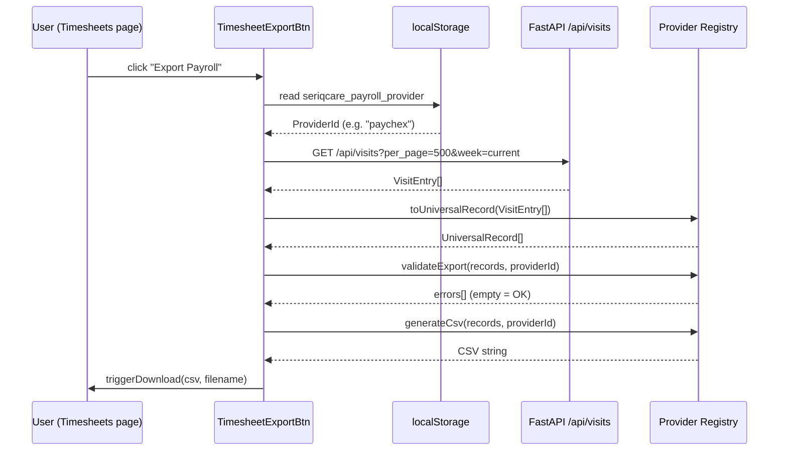
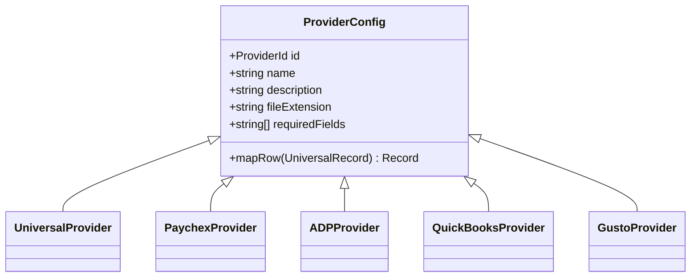

# Payroll Export System

## Overview

A provider-agnostic payroll export system that allows agencies to select their payroll platform in Settings and automatically use the correct export format when downloading timesheets. The architecture uses a **strategy pattern** (provider registry) so new providers can be added without touching existing ones.

---

## Architecture

```mermaid
flowchart TD
    A[Settings Page — Payroll Tab] -->|saves ProviderId| LS[(localStorage\nseriqcare_payroll_provider)]
    LS -->|reads on mount| B[TimesheetExportBtn\nClient Component]
    B -->|GET /api/visits| C[FastAPI visits endpoint]
    C -->|VisitEntry[]| B
    B -->|toUniversalRecord| D[UniversalRecord\nMaster Dataset]
    D -->|getProvider + mapRow| E{Provider Registry}
    E -->|paychex| F[Paychex CSV]
    E -->|adp| G[ADP CSV]
    E -->|quickbooks| H[QuickBooks CSV]
    E -->|gusto| I[Gusto CSV]
    E -->|universal| J[Universal CSV]
    F & G & H & I & J -->|triggerDownload| K[Browser Download]
```

---

## Data Flow



---

## Files Implemented

| File | Type | Purpose |
|------|------|---------|
| `lib/payroll/providers.ts` | New | Provider registry + `UniversalRecord` type |
| `lib/payroll/export.ts` | New | `toUniversalRecord`, `generateCsv`, `validateExport`, `triggerDownload` |
| `components/timesheet-export-btn.tsx` | New | Client component — reads provider, fetches, exports |
| `app/settings/page.tsx` | Modified | Added **Payroll** tab with provider tile selector |
| `app/timesheets/page.tsx` | Modified | Replaced static button with `<TimesheetExportBtn />` |

---

## Universal Master Dataset

All exports pull from this single record shape (`UniversalRecord`). No provider mapping ever mutates the source — each provider returns a new object.

| Field | Type | Source |
|-------|------|--------|
| `EmployeeID` | number | `visits.id` |
| `ExternalEmployeeCode` | string | `visits.employee_code` |
| `FirstName` | string | First token of `employee_name` |
| `LastName` | string | Remaining tokens of `employee_name` |
| `AgencyID` | string | Static `"1"` |
| `AgencyName` | string | `"SeriqCare Home Health"` |
| `DepartmentCode` | string | Static `"ODP"` |
| `LocationCode` | string | Static `"12"` (Home) |
| `TimesheetID` | number | `visits.id` |
| `VisitID` | number | `visits.id` |
| `ClientID` | string | `visits.client_name` |
| `ServiceType` | string | Static `"W7076"` |
| `ClockIn` | string | `visits.clock_in` |
| `ClockOut` | string | `visits.clock_out` |
| `TotalHours` | number | `visits.total_hours` |
| `PayrollHours` | number | `TotalHours` minus OT (≤8 h/day) |
| `PayRateUsed` | number | `0` (not yet in API) |
| `GrossPay` | number | `0` (not yet in API) |
| `PayPeriodStart` | string | `visits.service_date` |
| `PayPeriodEnd` | string | `visits.service_date` |
| `PayDate` | string | `visits.service_date` |
| `ClockInGPS` | string | `"lat,lon"` or `""` |
| `ClockOutGPS` | string | `"lat,lon"` or `""` |
| `Verified` | string | `"Yes"` if EVV Processed/Verified |
| `CorrectionReason` | string | `""` |
| `OT_Hours` | number | `max(0, TotalHours - 8)` |
| `HolidayHours` | number | `0` |
| `DifferentialType` | string | `""` |
| `DifferentialAmount` | number | `0` |
| `TravelTimeHours` | number | `0` |
| `Notes` | string | `""` |

---

## Provider Registry



### Provider Column Mappings

#### Paychex Flex

| Export Column | Maps From |
|---------------|-----------|
| `EmployeeID` | `ExternalEmployeeCode` |
| `LastName` | `LastName` |
| `FirstName` | `FirstName` |
| `Department` | `DepartmentCode` |
| `JobCode` | `ServiceType` |
| `Date` | `ClockIn` (date only) |
| `Hours` | `PayrollHours` |
| `Overtime` | `OT_Hours` |
| `Holiday` | `HolidayHours` |
| `Rate` | `PayRateUsed` |
| `Earnings` | `GrossPay` |
| `PayPeriodStart` | `PayPeriodStart` |
| `PayPeriodEnd` | `PayPeriodEnd` |
| `Notes` | `Notes` |

#### ADP Workforce Now

| Export Column | Maps From |
|---------------|-----------|
| `FileNumber` | `ExternalEmployeeCode` |
| `EmployeeName` | `FirstName + LastName` |
| `DeptCode` | `DepartmentCode` |
| `Location` | `LocationCode` |
| `PayCode` | `DifferentialType` or `ServiceType` |
| `HoursWorked` | `PayrollHours` |
| `OvertimeHours` | `OT_Hours` |
| `HolidayHours` | `HolidayHours` |
| `Rate` | `PayRateUsed` |
| `Amount` | `GrossPay` |
| `CheckDate` | `PayDate` |
| `BatchID` | `TimesheetID` |
| `Notes` | `Notes` |

#### QuickBooks Time

| Export Column | Maps From |
|---------------|-----------|
| `Employee` | `FirstName + LastName` |
| `ExternalID` | `ExternalEmployeeCode` |
| `Customer/Client` | `ClientID` |
| `ServiceItem` | `ServiceType` |
| `StartTime` | `ClockIn` |
| `EndTime` | `ClockOut` |
| `Duration` | `TotalHours` |
| `Billable` | `Verified` (Yes/No) |
| `PayrollItem` | `DifferentialType` or `ServiceType` |
| `PayRate` | `PayRateUsed` |
| `Notes` | `Notes` |

#### Gusto

| Export Column | Maps From |
|---------------|-----------|
| `employee_id` | `ExternalEmployeeCode` |
| `first_name` | `FirstName` |
| `last_name` | `LastName` |
| `department` | `DepartmentCode` |
| `work_date` | `ClockIn` (date only) |
| `hours_worked` | `PayrollHours` |
| `overtime_hours` | `OT_Hours` |
| `hourly_rate` | `PayRateUsed` |
| `gross_pay` | `GrossPay` |
| `pay_period_start` | `PayPeriodStart` |
| `pay_period_end` | `PayPeriodEnd` |
| `notes` | `Notes` |

---

## Settings UI — Payroll Tab

A new **Payroll** tab was added to `Settings` (alongside General / Notifications / Billing / Security).

```
┌─────────────────────────────────────────────────────────┐
│  Payroll Provider                                       │
│  Select the payroll system your agency uses.            │
│                                                         │
│  ┌──────────┐ ┌──────────┐ ┌──────────┐               │
│  │ ✓ UNI   │ │  PAY     │ │  ADP     │               │
│  │Universal │ │Paychex   │ │ADP WFN   │               │
│  └──────────┘ └──────────┘ └──────────┘               │
│  ┌──────────┐ ┌──────────┐                             │
│  │  QUI     │ │  GUS     │                             │
│  │QuickBooks│ │Gusto     │                             │
│  └──────────┘ └──────────┘                             │
│                                                         │
│  [Save Provider]  ✓ Saved — Universal Export            │
└─────────────────────────────────────────────────────────┘
```

- Selection stored in `localStorage` under key `seriqcare_payroll_provider`
- An **Export Field Reference** table below shows exact column names for the currently selected provider

---

## Timesheets Page — Export Button

The static "Export Payroll" button was replaced with `<TimesheetExportBtn />`, a client component that:

1. Reads `seriqcare_payroll_provider` from localStorage on mount
2. Displays `via {ProviderName}` beneath the button
3. On click: fetches `/api/visits?per_page=500&week=current`, maps to `UniversalRecord[]`, validates required fields, generates CSV, triggers browser download
4. Falls back to a user-visible error message if the API is unreachable or validation fails

---

## Adding a New Provider

1. Open `lib/payroll/providers.ts`
2. Add a new entry to `PROVIDERS` with a unique `ProviderId`
3. Implement `mapRow(r: UniversalRecord)` returning the provider's column layout
4. Optionally add `requiredFields` for pre-export validation

No other files need to change.

---

## Not Yet Implemented (Future Phases)

- **Audit logging** — log provider changes and each export event with timestamp (noted as out of scope)
- **Server-side export** — stream large exports via a FastAPI endpoint for datasets > 500 rows
- **PayRateUsed / GrossPay** — currently `0`; requires a `pay_rates` table linked to employee + service type
- **Per-employee pay period** — currently uses `service_date` as both start and end; requires a payroll calendar table
